  <picture>
    <source media="(prefers-color-scheme: dark)" srcset="./banner-dark.svg">
    <source media="(prefers-color-scheme: light)" srcset="./banner-light.svg">
    
  </picture>

   

  <!-- Dynamic Typing Headline -->
  

   

  <!-- Quick Action & Social Badges -->
  

    
    &nbsp;
    
    &nbsp;
    
  

---

### 💡 About Me

I bridge the gap between **machine learning models** and **scalable, production-grade web applications**. My workflow covers the full development cycle: from exploratory data analysis, data preprocessing, and model training in **Python & PyTorch** to architecting robust APIs in **Flask / FastAPI / Node.js** and delivering responsive, production interfaces in **Next.js & TypeScript**.

- 💼 **Current Position:** Full Stack Next.js Developer at **Alkhidmat Foundation – Digital**, Lahore
- 🧠 **Machine Learning:** Predictive Modeling, Deep Learning (CNNs), Classification & Time-Series Regression
- 💻 **Full-Stack Engineering:** React / Next.js (App Router), TypeScript, Tailwind CSS, Python (Flask/FastAPI), PostgreSQL, MongoDB
- 🔮 **Current Exploration:** Generative AI, Large Language Models (LLMs), RAG pipelines & Autonomous AI Agents
- 🤝 **Open For:** **Machine Learning Engineer**, **AI Engineer**, and **Full Stack Developer** roles (Lahore, Hybrid, or Global Remote)

---

### 🛠️ Tech Stack &amp; Tools

<table>
  <tr>
    <td width="25%" valign="top"><b>🧠 AI &amp; Machine Learning</b></td>
    <td width="75%">
      
        
      
      
      
      
      
      
    </td>
  </tr>
  <tr>
    <td width="25%" valign="top"><b>💻 Frontend &amp; UI</b></td>
    <td width="75%">
      
    </td>
  </tr>
  <tr>
    <td width="25%" valign="top"><b>⚙️ Backend &amp; Databases</b></td>
    <td width="75%">
      
        
      
      
    </td>
  </tr>
  <tr>
    <td width="25%" valign="top"><b>🚀 DevOps &amp; Workflow</b></td>
    <td width="75%">
      
    </td>
  </tr>
</table>

---

### 📌 Featured Projects

<table>
  <thead>
    <tr>
      <th width="40%">Project &amp; Highlights</th>
      <th width="35%">Tech Stack</th>
      <th width="25%">Links</th>
    </tr>
  </thead>
  <tbody>
    <tr>
      <td>
        <b>💎 Finlytics — AI Financial Intelligence</b> 
        Personal finance dashboard with automated transaction tracking, category breakdowns, Pandas analytical reports, CSV data pipeline, and predictive next-month expense forecasting with Linear Regression.
      </td>
      <td>
        <code>Next.js</code> <code>TypeScript</code> <code>Tailwind</code> 
        <code>Flask</code> <code>SQLAlchemy</code> <code>Scikit-learn</code>
      </td>
      <td>
        <a href="https://my-finance-frontend-mu.vercel.app/" target="_blank"><b>🌐 Live Demo</b></a> 
        <a href="https://github.com/Kazim0071/my-finance-frontend" target="_blank">💻 Frontend</a> &nbsp;|&nbsp; <a href="https://github.com/Kazim0071/my-finance" target="_blank">⚙️ Backend</a>
      </td>
    </tr>
    <tr>
      <td>
        <b>📊 Telecom Customer Churn Prediction</b> &nbsp; 
        End-to-end production predictive pipeline for telecom subscriber retention: exploratory data analysis, class imbalance mitigation (SMOTE), feature selection, cross-validation, and risk-scoring inference API.
      </td>
      <td>
        <code>Python</code> <code>Scikit-learn</code> 
        <code>Pandas</code> <code>NumPy</code> <code>Flask</code>
      </td>
      <td>
        <a href="https://github.com/Kazim0071/churn-detection" target="_blank"><b>📂 Repository ↗</b></a>
      </td>
    </tr>
    <tr>
      <td>
        <b>🧠 Deep Learning with PyTorch</b> 
        Deep neural network training framework: modular training and validation loops, custom PyTorch Dataset &amp; DataLoader pipelines, and CNN architectures (TinyVGG) for computer vision multi-class image classification.
      </td>
      <td>
        <code>PyTorch</code> <code>Torchvision</code> 
        <code>Python</code> <code>Matplotlib</code>
      </td>
      <td>
        <a href="https://github.com/Kazim0071/Deep-Learning-with-PyTorch" target="_blank"><b>📂 Repository ↗</b></a>
      </td>
    </tr>
    <tr>
      <td>
        <b>🫀 Heart Disease Clinical Classification</b> 
        Diagnostic machine learning study benchmarking Logistic Regression, KNN, and Random Forest classifiers on clinical health data. Hyperparameter optimization via RandomizedSearchCV &amp; GridSearchCV, evaluated with ROC-AUC.
      </td>
      <td>
        <code>Scikit-learn</code> <code>Pandas</code> 
        <code>NumPy</code> <code>Seaborn</code> <code>Matplotlib</code>
      </td>
      <td>
        <a href="https://github.com/Kazim0071/heart-disease-classification" target="_blank"><b>📂 Repository ↗</b></a>
      </td>
    </tr>
    <tr>
      <td>
        <b>🚜 Bulldozer Auction Price Prediction</b> 
        Time-series regression modeling heavy machinery auction values. Implemented datetime feature decomposition, handled missing categorical variables, and tuned an ensemble Random Forest Regressor evaluated against RMSLE.
      </td>
      <td>
        <code>Python</code> <code>Scikit-learn</code> 
        <code>Pandas</code> <code>NumPy</code>
      </td>
      <td>
        <a href="https://github.com/Kazim0071/bulldozer-price-prediction" target="_blank"><b>📂 Repository ↗</b></a>
      </td>
    </tr>
    <tr>
      <td>
        <b>🛒 Amazona E-Commerce Platform</b> 
        Full-stack production-ready MERN online retail store featuring JWT authentication, stateful shopping cart, product catalog filtering, order management lifecycle, and PayPal payment checkout.
      </td>
      <td>
        <code>React</code> <code>Redux</code> <code>Node.js</code> 
        <code>Express</code> <code>MongoDB</code>
      </td>
      <td>
        <a href="https://github.com/Kazim0071/Ecommerce" target="_blank"><b>📂 Repository ↗</b></a>
      </td>
    </tr>
  </tbody>
</table>

---

### 🤝 Let's Connect

Whether you are looking for an engineer to architect an **end-to-end Machine Learning pipeline**, build an **intelligent full-stack web application**, or discuss **Generative AI &amp; Agentic Systems**, feel free to reach out.

   
  
  &nbsp;&nbsp;
  
  &nbsp;&nbsp;
  

    
  <b>Muhammad Qasim Amir</b> &nbsp;·&nbsp; Lahore, Pakistan

