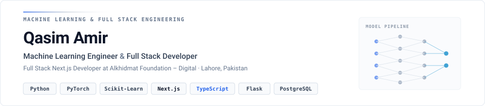

<picture>
  <source media="(prefers-color-scheme: dark)" srcset="./banner-dark.svg">
  
</picture>

  <a href="https://portfolio-frontend-seven-orpin.vercel.app/"><b>Portfolio</b></a>&nbsp;&nbsp;↗&nbsp;&nbsp;&nbsp;
  <a href="https://www.linkedin.com/in/qasimamir/"><b>LinkedIn</b></a>&nbsp;&nbsp;↗&nbsp;&nbsp;&nbsp;
  <a href="mailto:qasim.ameer.dk@gmail.com"><b>Email</b></a>&nbsp;&nbsp;↗

 

I build machine learning models and the full stack products that put them in front of real users — from data cleaning and model training in Python to APIs and fast, clean interfaces in Next.js.

 

## Selected Work

**01 &nbsp;—&nbsp; [Finlytics](https://my-finance-frontend-mu.vercel.app/)** &nbsp;·&nbsp; [frontend](https://github.com/Kazim0071/my-finance-frontend) · [backend](https://github.com/Kazim0071/my-finance)
 AI-powered personal finance dashboard with reports, CSV export and next-month expense forecasting.
 `Next.js` `TypeScript` `Flask` `SQLAlchemy` `Scikit-learn`

**02 &nbsp;—&nbsp; [Customer Churn Prediction](https://github.com/Kazim0071/churn-detection)** &nbsp;in progress
 End-to-end pipeline to predict telecom customer churn, from EDA to a served model.
 `Python` `Pandas` `Scikit-learn`

**03 &nbsp;—&nbsp; [Deep Learning with PyTorch](https://github.com/Kazim0071/Deep-Learning-with-PyTorch)**
 Training loops, neural network classifiers and CNNs (TinyVGG) for computer vision.
 `PyTorch` `Torchvision`

**04 &nbsp;—&nbsp; [Heart Disease Classification](https://github.com/Kazim0071/heart-disease-classification)**
 Logistic Regression, KNN and Random Forest compared and tuned, evaluated with ROC-AUC and cross-validation.
 `Scikit-learn` `Pandas` `Matplotlib`

**05 &nbsp;—&nbsp; [Bulldozer Price Prediction](https://github.com/Kazim0071/bulldozer-price-prediction)**
 Time-series regression on auction data with date features and a tuned Random Forest.
 `Scikit-learn` `Pandas` `NumPy`

 

## Stack

  

Currently learning Generative AI, LLMs and Agentic AI.

 

---

Lahore, Pakistan &nbsp;·&nbsp; Full Stack Next.js Developer at Alkhidmat Foundation – Digital &nbsp;·&nbsp; Open to ML Engineer, AI Engineer and Full Stack roles
